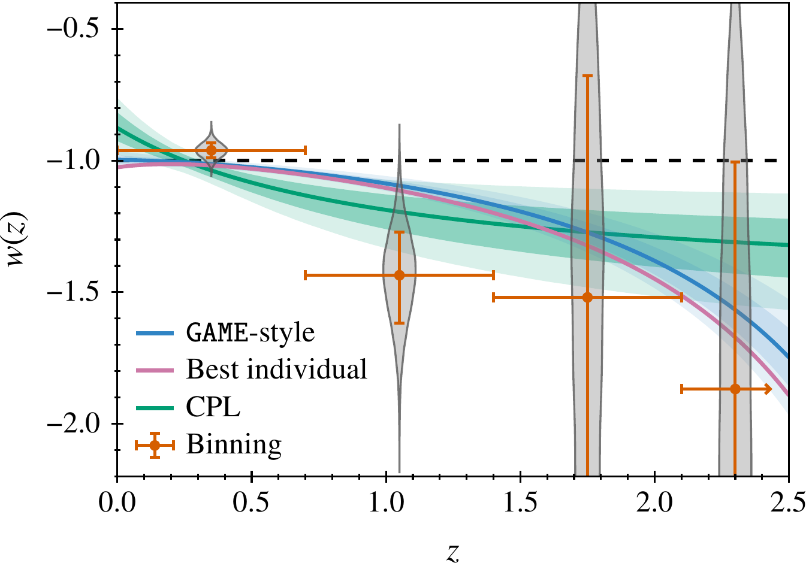

# A Genetic Algorithm Approach to Reconstructing Scalar–Tensor Lagrangians

This is the repository that contains the Julia code, data and plotting notebook that reproduce the results and
figures of [arXiv:XXXX.XXXXX](https://arxiv.org/abs/XXXX.XXXXX). A genetic algorithm evolves symbolic expressions for
the non-minimal coupling $F(\varphi)$ and the potential $U(\varphi)$ of a scalar–tensor theory, and ranks them
against DESI DR2 BAO, Pantheon+ and SH0ES, compressed CMB and $f\sigma_8$ data. See [USAGE.md](USAGE.md) for how to
run the code and [data/README.md](data/README.md) for the sources of the observational data.

## Abstract

Recent DESI baryon acoustic oscillation (BAO) data, combined with cosmic microwave background (CMB) and Type Ia
supernovae observations, have been interpreted as evidence for dynamical dark energy whose equation of state crosses
the phantom divide $w=-1$. Such a crossing cannot be realized smoothly by a minimally coupled scalar field $\varphi$,
but arises naturally in scalar-tensor theories. We present a data-driven framework that reconstructs the
scalar-tensor Lagrangian directly from observations. A genetic algorithm evolves symbolic expressions for the
nonminimal coupling $F(\varphi)$ and the scalar potential $U(\varphi)$. Each candidate is evaluated through a forward
model that self-consistently determines the expansion history, the effective gravitational coupling, and the growth
of structure. Candidates are ranked by a joint likelihood of DESI DR2 BAO, Pantheon+ supernovae calibrated with
SH0ES Cepheids, compressed CMB distance priors, and redshift-space distortion measurements of $f\sigma_8$. We
restrict to the unscreened branch of the theory and impose Solar System constraints on the post-Newtonian parameter
$\gamma$ and on the time variation of the gravitational coupling, together with a Big Bang nucleosynthesis bound on
its evolution. Across 64 independent runs, the best reconstruction improves the fit relative to $\Lambda\mathrm{CDM}$ by
$\Delta\chi^2=-16.6$, compared with $\Delta\chi^2=-10.6$ for the Chevallier–Polarski–Linder dark-energy
parametrization. The preferred coupling is well described by $F(\varphi)=c_1\varphi^2+e^{\varphi}(1-c_2\varphi)$.
The reconstructed theory shows phantom behavior at $z\gtrsim0.5$, but it remains close to $w=-1$ at low redshift.

## Citing the paper

If you use any of the above codes or the figures in a published work please cite the following paper:
 *A Genetic Algorithm Approach to Reconstructing Scalar–Tensor Lagrangians*
 Mikel Artola, George Alestas, Dimitrios Efstratiou and Evangelos Achilleas Paraskevas,
[arXiv:XXXX.XXXXX](https://arxiv.org/abs/XXXX.XXXXX)

If you use the observational data in `data/`, please also cite the original papers listed in
[data/README.md](data/README.md).

Any further questions/comments are welcome.

## Authors List

Mikel Artola - <mikel.artola@ehu.eus>
 George Alestas - <g.alestas@csic.es>
 Dimitrios Efstratiou - <d.efstratiou@uoi.gr>
 Evangelos Achilleas Paraskevas - <e.paraskevas@uoi.gr>
